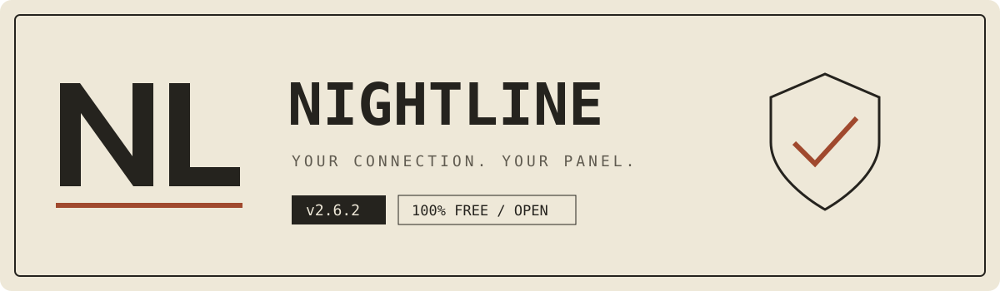
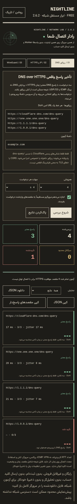

# NightLine 2.6.2 | اتصال شما، پنل شما
### ۱۰۰٪ رایگان · FREE · غیرقابل فروش

پنل فارسی و انگلیسی برای مدیریت اتصال روی **Cloudflare Workers و Pages**؛ با ظاهر روزنامه‌ای، حالت روشن/تاریک و رابط موبایل.

**[نصب آسان ↗](https://wild-hall-a780.gigity.workers.dev/)** · **[مخزن رسمی ↗](https://github.com/youdidking/NightLine)**

## تازه در ۲.۶.۲

- **آزمایشگاه شبکه و ابزار HTML مستقل**: بررسی مستقیم ریزالورهای Cloudflare و IPهای عمومی از مرورگر و اینترنت خودتان؛ نمونه‌گیری CIDR، توقف، فیلتر، زمان پاسخ، نوسان، کپی مقصدهای معتبر و خروجی JSON.
- **هشت بخش مشخص**: اشتراک، مشترکین، کارگاه WARP، اتصال پنل، آزمایشگاه، مسیریابی/DNS، مشاور و امنیت/پشتیبان.
- کارت‌های میان‌بر، وضعیت‌های سبز/قرمز/نارنجی، نمودار کوچک نمونه‌ها و حرکت‌های سبک؛ پشتیبانی از کاهش انیمیشن و صفحه‌کلید.
- کارگاه از پیشخوان جدا شد؛ فهرست IP، اسکن پیشرفتهٔ رنج‌ها و Relay Delay کنار هم قرار گرفتند.
- پاسخ مبهم مرورگر (`opaque`) دیگر پینگ موفق نیست. روش دریافت کلید از سرویس‌های عمومی ثالث حذف شد؛ ثبت رسمی و ورود حساب شخصی باقی‌اند.
- بازکردن تب مشاور دیگر خودکار آزمون شبکه اجرا نمی‌کند. ابزار HTML هم فقط با اجازه و زدن شروع درخواست می‌فرستد.

## نصب یا ارتقا

۱. **نصب‌کنندهٔ آماده** را باز کنید؛ Workers یا Pages را انتخاب و فقط توکن Cloudflare را طبق راهنمای همان صفحه وارد کنید. توکن GitHub لازم نیست.

۲. پیشرفت، خطا و نتیجه در همان صفحه‌اند. آدرس و رمز را امن نگه دارید و پس از نصب، توکن نصب را لغو کنید.

۳. کاربر بسازید و لینک اشتراک مناسب برنامهٔ او را کپی کنید یا QR را اسکن کنید.

**برای ارتقا، پشتیبان بگیرید و همان پروژه و فضای `KV` قبلی را حفظ کنید.** فایل آمادهٔ Worker در ریشهٔ مخزن `worker-single-file.js` است. نصب‌کننده آخرین فایل رسمی شاخهٔ `main` را می‌گیرد؛ خود این انتشار از راه دور مستقر نشده است.

## ابزار HTML را چطور باز کنم؟

- فایل **[NightLine-Network-Lab.html](NightLine-Network-Lab.html)** را دانلود و در مرورگر کامل خود باز کنید؛ نصب، Node.js یا Python برای بخش DNS/HTTPS لازم نیست.
- داخل پنل هم همین ابزار در تب **آزمایشگاه شبکه** است و دکمهٔ دانلود HTML مستقل دارد.
- در بخش DNS، ریزالورهای رسمی Cloudflare و دامنهٔ آزمون را انتخاب کنید. نتیجه، تأخیر **DNS over HTTPS** است؛ نه ICMP و نه UDP/53. کش ریزالور و استفادهٔ مجدد از اتصال روی زمان اثر دارند.
- در بخش IP، فهرست IP:Port یا CIDR عمومی وارد کنید؛ هم‌زمانی، مهلت و تعداد نمونهٔ هر رنج را تنظیم کنید. فقط پورت‌های TLS بررسی می‌شوند. سیگنال محدود برای انتقال خودکار به فهرست پنل استفاده نمی‌شود.
- فیلتر، کپی مقصدهای پاسخ‌دار و دانلود همهٔ نتایج در JSON در دسترس است. ابزار کلید حساب نمی‌خواهد و نتیجه را خودکار ذخیره نمی‌کند.

| رنگ | معنی |
| :--- | :--- |
| سبز | پاسخ معتبر و قابل بررسیِ همان آزمون؛ نه تضمین اتصال تونل |
| نارنجی | پاسخ مبهم مرورگر یا نمونهٔ ناکافی؛ نیازمند بررسی در کلاینت |
| قرمز | آزمون تأیید نشده؛ لزوماً به معنی مسدودبودن مقصد نیست |

> پیش‌نمایش محدودِ فایل ممکن است دسترسی شبکه نداشته باشد؛ فایل دانلودشده را در مرورگر کامل باز کنید. VPN یا پراکسی مرورگر روی مسیر آزمون اثر دارد. فقط مقصد مورد اعتماد خودتان را بررسی کنید.

## WireGuard و WARP چطور؟

**HTML معمولی نمی‌تواند سوکت UDP دلخواه یا handshake واقعی WireGuard به سرور WARP بفرستد.** WebTransport نیز سرور HTTP/3 سازگار می‌خواهد؛ جایگزین آن نیست. این ابزار پینگ HTTP را به‌جای WireGuard نشان نمی‌دهد.

برای آزمون واقعی از شبکهٔ خودتان، ابزار محلی Node.js همراه سورس را اجرا کنید و JSON نتیجه را در بخش WireGuard آزمایشگاه یا کارگاه وارد کنید. کلید خصوصی روی کامپیوتر خودتان می‌ماند؛ در پنل، بهترین مقصدِ گزارش خودتان را می‌توانید به حساب WireGuard بارگذاری‌شده اعمال کنید.

**[راهنمای قدم‌به‌قدم ابزار محلی](tools/README_FA.md)**

موفقیت handshake به معنی سرعت، پایداری، عبور دادهٔ کامل یا تضمین اتصال در ایران نیست. این آزمون مخصوص WireGuard است، نه MASQUE.

## کارگاه اتصال

- ثبت رسمی حساب شخصی یا ورود فایل: WireGuard تک‌Peer با `.conf` یا JSON پشتیبان؛ MASQUE با JSON معتبر usque/کارگاه.
- کلید شخصی در مرورگر ساخته می‌شود و برای ثبت، فقط کلید عمومی ارسال می‌شود. کلیدها در KV یا localStorage ذخیره نمی‌شوند؛ **پشتیبان بگیرید، چون با بستن/تازه‌کردن تب پاک می‌شوند.**
- در خطای 403 مسیر رسمی جایگزین `api.devices.cloudflare.com` را انتخاب کنید؛ در 429 صبر کنید و برای دورزدن محدودیت میزبان‌ها را پشت‌سرهم عوض نکنید.
- AmneziaWG: تنظیم `Jc/Jmin/Jmax` و `I1–I5` اختیاری؛ مقادیر سمت سرور برای WARP ثابت‌اند. این فایل برای WireGuard عادی نیست.
- MASQUE/H2: اندازه و تأخیر Fragment قابل تنظیم؛ H3 این Fragment را ندارد. TLS خاموش نمی‌شود.
- متن کانفیگ را ویرایش، کپی یا دانلود کنید؛ تغییر گزینه‌ها آن را دوباره می‌سازد. متن دستی اعتبارسنجی پروتکل نمی‌شود.

**خروجی WARP مستقل از مشترک، سهمیه و انقضای Worker است.** ساخت فایل یا ثبت حساب تأیید اتصال نیست؛ فایل‌ها و پشتیبان محرمانه‌اند.

## امکانات اصلی حفظ شده‌اند

VLESS و Trojan، کاربران مستقل و مصرف/اعتبار، کارت و QR اشتراک، کشور تقریبی در نام نود و لینک‌ها، ProxyIP و پروکسی زنجیره‌ای، DNS خصوصی، پروکسی رسمی وب تلگرام، مشاور و بروزرسانی داخل پنل. WhiteVPN برای دسکتاپ و CoreForge/TestFlight برای iOS در فهرست برنامه‌ها باقی‌اند.

در «اسکن پیشرفته و Relay»، فهرست IP پنل را مدیریت کنید؛ Relay با یک گرم‌کردن و پنج تلاش، پاسخ واقعی HTTP 204 تونل کاربر انتخابی را بررسی می‌کند. شناسهٔ اتصال به مقصد انتخابی ارسال می‌شود؛ فقط مقصد مورد اعتماد وارد کنید. ترکیب IP خام با نام TLS دامنه نیازمند تست در کلاینت است.

## چند نکتهٔ ضروری

- پنل رایگان است، اما منابع Cloudflare نامحدود نیستند؛ این انتشار تضمین حذف خطای CPU پلن Free نیست.
- کشورها موقعیت تقریبی IP ورودی‌اند، نه تضمین کشور خروجی. IP خالی هم خروجی ثابت همهٔ سایت‌ها نمی‌سازد.
- اعلان رایگان‌بودن، مصرف و اعتبار بخش ثابت سرویس است.
- هیچ تنظیم DPI یا فهرست IP، اتصال دائمی روی همهٔ اپراتورهای ایران را تضمین نمی‌کند.

ساخت از سورس: Node.js 22+ و Python 3 با `fonttools[woff]` برای فونت، سپس `npm ci` و `npm run build:pages`. **اسکنر Python وجود ندارد**؛ ابزار HTML به ساخت محلی نیاز ندارد. خروجی Pages در `dist/nightline-pages.zip` ساخته می‌شود. فایل‌های تولیدی `src/generated` در ZIP مخزن نیستند و هنگام build ساخته می‌شوند.

گزارش فنی در `TEST_REPORT_FA.md` و `RESEARCH_NOTES_FA.md`، تغییرات در `RELEASE_NOTES_FA.md` و مجوزها در فایل‌های مربوط‌اند. با سپاس از مستندات WireGuard، Cloudflare، AmneziaWG، Xray و پژوهش‌های lanrat/usque/DarknessShade؛ سرویس کلید ثالث در رابط این نسخه استفاده نمی‌شود.

**رایگان و غیرقابل فروش.** [مجوز پروژه](LICENSE)

